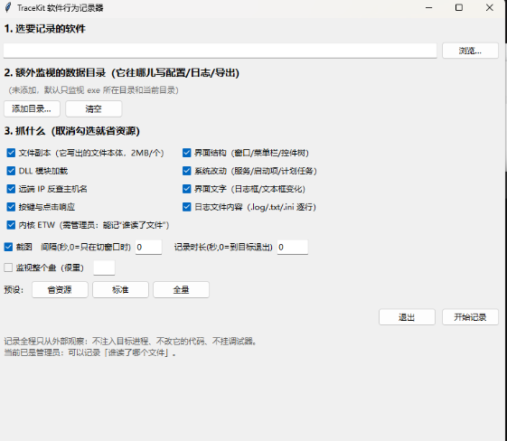
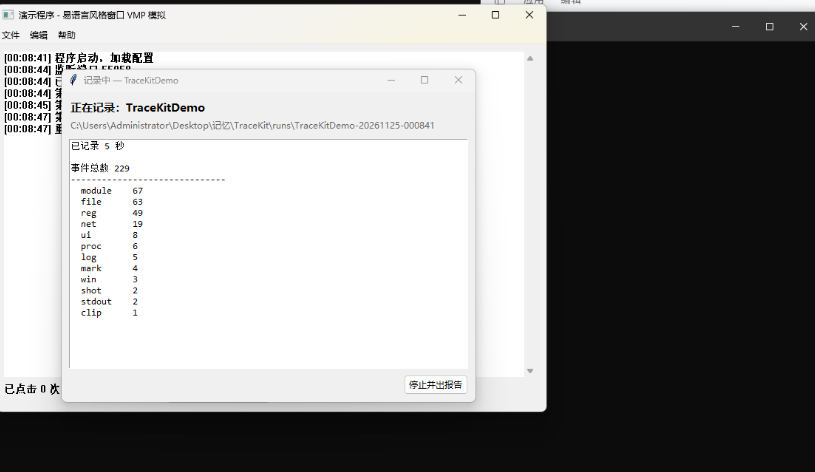
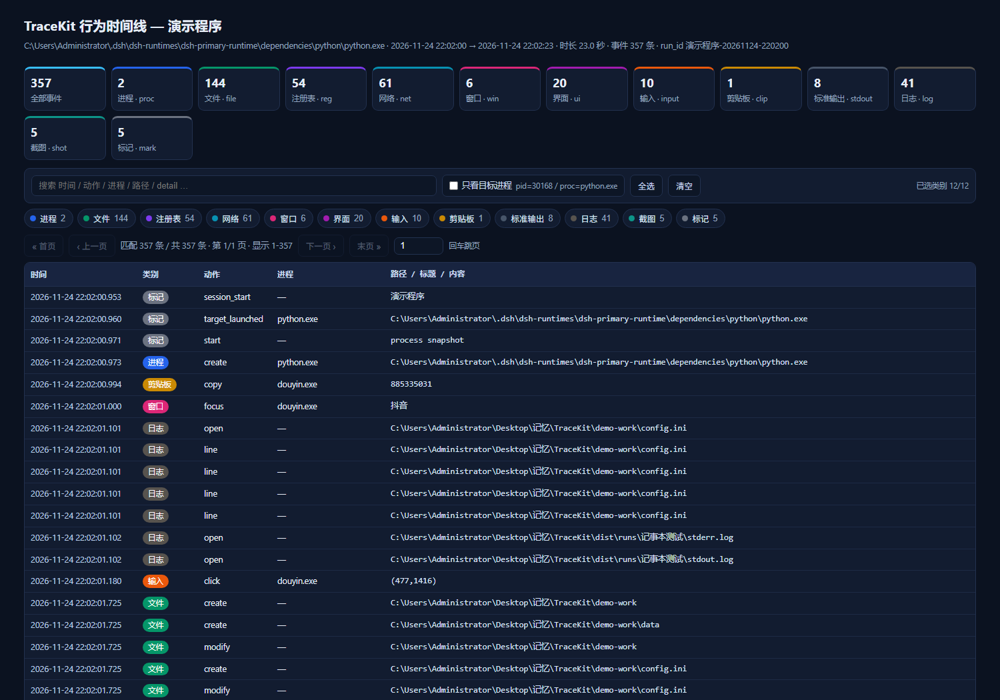

# TraceKit — Windows 软件行为记录器

[](https://github.com/OWNER/tracekit-win/actions/workflows/ci.yml)
[](LICENSE)
[](pyproject.toml)

> **TL;DR (English)** — TraceKit records what *another* Windows program does: processes & full command lines,
> file reads/writes (kernel ETW), registry changes, TCP/UDP with byte counts, window/menu/control trees,
> which control you clicked and what changed afterwards, the target's own on-screen log text, log-file lines,
> clipboard (text/files/images), loaded DLLs, system-surface changes (services/autoruns/tasks) and crash evidence.
> Everything runs **from outside** the target — no injection, no patching, no debugger — so it also works against
> **EasyLanguage (易语言) + VMProtect** packed binaries. Zero third-party dependencies (ctypes + stdlib only).
> Output is a Chinese Markdown report, a single-file interactive HTML timeline, and machine-readable
> `events.jsonl` / `events.sqlite`. Docs are in Chinese below.

> ⚠️ 只用于分析**你自己写的**或**你有明确授权**的软件；`SECURITY.md` 写了用途边界与数据处理。

|  |  |
| --- | --- |
| 双击向导 |  |
| 记录中（实时计数） |  |
| 单文件时间线 |  |

把任意一个 Windows 软件套进来运行（或挂到已运行的进程上），**从外部**记录它做了什么：
进程树、读写的文件、读写的注册表、网络连接、窗口/焦点/截图、**它自己界面上的日志文字**、
它的日志文件内容、键盘鼠标、剪贴板、标准输出。

不注入目标进程、不改目标代码、不附加调试器、不装驱动 —— 所以**对易语言 + VMProtect 加壳的程序照样有效**，
因为记录发生在壳的下面（内核）和壳的外面（窗口/输入/目录），而不是去反编译它的虚拟化代码。

### 安装 / 运行

```bash
git clone https://github.com/OWNER/tracekit-win.git && cd tracekit-win

# 方式一：源码直接跑（零依赖，Python 3.9+ 自带 ctypes 即可）
python -m tracekit              # 打开可视化向导
python -m tracekit selftest     # 自测：11 个采集层是否都出数据

# 方式二：装成命令
pip install .                   # 之后有 tracekit / tracekit-gui 两个命令
tracekit-gui                    # 向导

# 方式三：单文件 EXE（不需要装 Python）
powershell -ExecutionPolicy Bypass -File build_exe.ps1
# 产物 dist\TraceKit.exe，双击即用；Release 页也会挂一个
```


## 零、最省事的用法：双击 `TraceKit.exe`

双击后是一个**可视化向导**（一个窗口搞定，不用记任何参数）：

1. **选要记录的软件**：① 浏览选 `.exe`
2. **额外监视的数据目录**：② 添加它写配置/日志/导出的目录（可多个）
3. **抓什么**：③ 九个勾选项，取消就省资源
   `文件副本` / `界面结构` / `DLL 模块加载` / `系统改动` / `主机名反查` /
   `界面文字` / `按键与点击响应` / `日志文件内容` / `内核 ETW（需管理员）`
   - 下面还有：`截图`（可设间隔）、`记录时长`（0 = 录到目标自己退出）、`监视整个盘`
   - **预设**按钮：`省资源` / `标准` / `全量` 一键切换勾选组合
4. **开始记录** → 弹出一个置顶小窗，实时显示 `已记录 N 秒` 和各类事件计数
   （`file 97 / reg 49 / net 30 / module 3 …`），随时可以点 **停止并出报告**
5. 结束后自动出报告，并问你要不要打开时间线；输出在 EXE 旁边的 `runs\<软件名>-<时间>\`

命令行用法完全保留（同一个 EXE）：

```
TraceKit.exe                              # 双击 = 打开向导
TraceKit.exe probe "C:\你的软件\app.exe"    # 只体检：位数/壳/易语言特征/导入表
TraceKit.exe run --profile full --name 目标软件 "C:\你的软件\app.exe"
TraceKit.exe attach --title 目标软件 --duration 300
TraceKit.exe report runs\目标软件-20261124-213000
TraceKit.exe selftest                     # 自测：11 个记录层是否都出数据
```

记录结束后自动生成（**中文文件名、中文内容、UTF-8 带 BOM，记事本/Word/WPS 直接打开不乱码**）：

| 文件 | 内容 |
| --- | --- |
| `报告.md` | 中文分析报告：进程树、文件/注册表/网络汇总、窗口与按键序列、日志内容、时间线表格 |
| `时间线.html` | 单文件交互式时间线（搜索、按类别过滤、只看目标进程、展开详情、看截图） |
| `日志汇总.txt` | **目标的日志汇总**：按文件分组逐行日志 + **用户动作与程序响应配对** + 界面日志框最终全文 |
| `截图\` | 截图 PNG（焦点切换时 / 定时） |
| `界面结构.txt` | 目标每个窗口的**结构快照**：类名、位置、菜单栏全部菜单项（含 id）、控件树（类/id/文字/坐标/可见/禁用） |
| `模块清单.txt` | 目标加载过的**每个 DLL**（含中途退出进程，累计历史）：基址、大小、首次/末次时间 |
| `系统改动.txt` | 记录期间**系统面的改动**：服务 / 自启动项（Run、RunOnce、Winlogon）/ 计划任务 / 启动文件夹 |
| `文件副本\` | 目标生成或改写过的文件**本体副本**（SHA1 命名去重，单文件 2MB、总量 200MB 上限） |
| `剪贴板图片\` | 剪贴板里的图片（CF_DIB → BMP） |
| `崩溃信息.txt` | 目标崩溃时留下的 WER 转储/报告证据（有才生成） |
| `events.jsonl` | 机器可读事件流，一行一条（UTF-8 无 BOM，方便 grep / 导入） |
| `events.sqlite` | 索引库 `events(seq,t,ts,cat,act,pid,ppid,proc,path,detail)`，随便 SQL 统计 |
| `stdout.log` / `stderr.log` | 目标的标准输出（自动识别 UTF-8 / GBK，不会写成乱码） |
| `run_meta.json` | 会话元数据 + PE 体检结果 + 运行时判定 + 各模块开关 |

### 编码约定（为什么不会乱码）

| 文件类型 | 编码 | 原因 |
| --- | --- | --- |
| 给人看的 `报告.md` / `日志汇总.txt` / `stdout.log` | **UTF-8 + BOM，CRLF** | 中文 Windows 记事本/WPS 默认按 GBK 猜，带 BOM 才稳 |
| 给程序用的 `events.jsonl` / `时间线.html` / `run_meta.json` | UTF-8 无 BOM | 标准工具直接可用，HTML 里有 `<meta charset="utf-8">` |
| 截获目标 stdout/stderr 的字节流 | 先严格按 UTF-8 解，失败再按 **GB18030**（易语言常见），最后才兜底替换 | 避免把 GBK 中文硬解成 `���` |
| 日志文件增量（`日志汇总.txt` 的内容源） | 同上，且跨读取边界保留半个多字节字符 | 不会把汉字从中间截断成乱码 |

---

## 一、能记录什么（能力矩阵）

| 类别 `cat` | 记录内容 | 粒度 | 依赖 | 对 VMP 壳有效？ |
| --- | --- | --- | --- | --- |
| `proc` | 目标进程 + 它派生的所有子进程/孙进程：创建、退出、**完整命令行**、工作目录、位数、父子关系、存活时长 | 200ms 轮询（可调 `--proc-interval`） | 无 | ✅ 壳管不着 |
| `file` | 目录内所有文件/子目录的**创建/修改/删除/改名**，含文件大小、是否目录、发生次数、时间跨度 | ReadDirectoryChangesW，递归、静态/持久都能抓 | 无需管理员 | ✅ |
| `file`（ETW） | **哪个 PID 读了/写了哪个文件**，写入字节数、读偏移（`read`/`write`/`create`/`delete`/`rename`） | 内核 ETW，事件级 | 管理员 + ETW | ✅ 唯一能拿到「谁读的」的层 |
| `reg` | 注册表键/值的**新建、删除、修改**，含旧值→新值、值类型 | `RegNotifyChangeKeyValue` 推送 + 快照 diff | 无需管理员 | ✅ |
| `net` | 每个 socket 的 `connect`/`listen`/`bind`/状态迁移/`close`，本地→远端 IP:端口 | 1s 轮询（可调） | 无 | ✅ |
| `win` | 前台窗口切换序列（标题+类名+进程）、目标新开窗口（对话框/子窗口）、关闭 | 250ms | 无 | ✅ |
| `ui` | **目标自己界面里的文字**：Edit/ListBox/Static/SysListView32 等控件文本的每次变化（易语言的「运行日志」框就在这里） | 1s 抓一次，变化即记 | 无 | ✅ 用 `WM_GETTEXT` 系统消息编组，不注入 |
| `ui/click` | **点了哪个控件**：类名 + 标题 + 控件ID + 所属窗口 + 连击次数 + 修饰键 + 是否程序注入；弹出菜单会解析出菜单项文字 | 每次真实点击一条 | 全局鼠标钩子 + `WindowFromPoint` | ✅ |
| `ui/response` | **按钮/控件的响应**：动作后 0.7s 抓同窗口控件状态与文本差分（按钮标题、复选框勾选态、下拉选择、列表选中、日志框内容、新弹窗口/关窗），与触发动作配对 | 每个动作一条（无变化则不记） | `BM_GETCHECK`/`CB_GETCURSEL`/`LB_GETCURSEL`/`WM_GETTEXT` | ✅ 纯消息，不注入 |
| `ui/key_target` | 按键**落在哪个控件**（焦点控件类名/标题/ID），把原始键码和界面元素对上 | 每个按键一条 | `GetGUIThreadInfo` | ✅ |
| `ui/tree` | **界面结构**：窗口类名/标题/尺寸、**菜单栏全部菜单项（含 id、子菜单）**、控件树（类/id/文字/坐标/可见/禁用）；结构变化才记 | 3s 或窗口变化时 | `GetMenu`/`GetMenuItemCount`/`EnumChildWindows` | ✅ 跨进程查菜单 |
| `file/snapshot` | **文件本体副本**：它生成/改写的文件抄进 `文件副本\`，SHA1 去重，文本文件带内容预览 | 事件驱动 | 无 | ✅ |
| `module` | 目标加载过的**每个 DLL/模块**：完整路径、基址、大小、首次出现；退出时汇总成 `模块清单.txt` | 2.5s 轮询 | Toolhelp 模块快照 | ✅ |
| `sys` | **系统面改动**：服务、自启动（Run/RunOnce/Winlogon）、计划任务、启动文件夹的新增/删除/修改 | 基线+收尾各一次 | 注册表 + 文件系统只读 | ✅ |
| `net/host` | 远端 IP **反向解析主机名**（`net/host` / `net/host_unknown`），给连接补上可读目标 | 异步 3 线程 | 系统 DNS | ✅ |
| `clip`（多格式） | 剪贴板不只文本：**文件列表**（CF_HDROP）、**图片**（CF_DIB→BMP 落盘）、**HTML 片段**，以及当前格式清单 | 400ms 变化检测 | 无 | ✅ |
| `crash` | 目标异常退出时回查 WER 转储/报告，落 `崩溃信息.txt` | 收尾一次 | 文件系统 | ✅ |
| `input` | 全局按键（虚拟码 + **实际字符** + ctrl/alt/shift 修饰 + 是否程序注入）、鼠标点击/滚轮坐标、当时焦点窗口 | 全局低级钩子，实时 | 无 | ✅ 钩子在本进程，壳看不见 |
| `clip` | 剪贴板文本（变化时），长文本截断保存 | 400ms | 无 | ✅ |
| `log` | **被监视目录里文本类文件（.log/.txt/.ini/.csv/.json/...）的内容增量**，一行一个事件；自动识别 UTF-8 / GB18030 | 800ms 增量读 | 无 | ✅ 日志文字直接落到报告里 |
| `stdout/stderr` | 目标的标准输出/错误（GUI 程序通常为空） | 行级 | 启动时接管管道 | ✅ |
| `shot` | 截图（焦点切换时 + 可选定时），带当前焦点窗口标题时间 | PNG | Pillow（已内置） | ✅ |
| `mark` | 会话开始/结束、目标启动/挂载、**PE 体检结论**、**运行时判定** | 点事件 | 无 | ✅ |

## 二、记录不到的（以及替代做法）

| 做不到 | 原因 | 替代 |
| --- | --- | --- |
| 目标进程内部的函数调用、变量值、VMP 虚拟机里的真实逻辑 | VMP 把代码虚拟化，反编译/调试器看到的都是壳；硬挂调试器还会触发反调试 | 不需要。行为层（文件/注册表/网络/输入/界面）已经能还原「它在干什么」；真要 API 级，用 ETW 的 `Kernel-File/Registry/Network` + 自写 minifilter |
| 纯读文件（谁读了哪个文件）用目录通知拿不到 | `ReadDirectoryChangesW` 只报目录变化 | 开 ETW（默认开，需管理员）：`--no-etw` 可关 |
| 加密流量内容 | 记录器不做中间人 | 需要明文就挂本地代理（Fiddler/mitmproxy），`net` 事件里已有目标地址可对齐 |
| 控件里的 SysListView32 逐行文字 | `LVM_GETITEMTEXT` 需要跨进程读内存 | 用截图 + `ui` 里其它控件文本；重要的话再加 UIA（`--ui` 已在抓非 ListView 控件） |
| 目标内部写到「U盘/网络盘」的瞬时文件 | 目录不在监视列表 | `--watch-dir` 加路径；`--watch-temp` 把 TEMP 也纳入 |

## 三、常见用法

```bat
:: 只是看看它写了哪些文件、弹了哪些窗口
python -m tracekit run --name 客户软件 "D:\客户软件\app.exe" --no-input --no-ui

:: 全量：连它界面日志、日志文件、按键、截图都记
python -m tracekit run --name 客户软件 --watch-dir "D:\客户软件\data" --shot-interval 30 "D:\客户软件\app.exe"

:: 已经开着了，挂上去记 5 分钟
python -m tracekit attach --title 客户软件 --duration 300

:: 只换报告格式，不重录
python -m tracekit report runs\客户软件-20261124-213000
```

常用开关：

| 开关 | 作用 |
| --- | --- |
| `--watch-dir DIR` | 额外监视目录（可重复）；默认监视 exe 目录 + 当前目录 |
| `--watch-temp` | 把 `%TEMP%` 也纳入（噪声大，默认关） |
| `--exclude-dir DIR` | 排除目录（默认已排除输出目录） |
| `--reg-root HKCU\Software` | 监视哪些注册表根（可重复，默认 `HKCU\Software`） |
| `--reg-depth N` | 注册表递归深度（默认 4） |
| `--shot-interval S` | 每 S 秒截一张（默认 0=只在焦点切换时截） |
| `--proc-interval S` | 进程快照间隔（默认 0.2s，越小越不漏短命子进程） |
| `--duration S` | 记录 S 秒后自动停（默认等目标退出） |
| `--no-file/--no-reg/--no-net/--no-win/--no-ui/--no-input/--no-tail/--no-etw/--no-report` | 关掉某个记录器 |
| `--no-uiact` | 只记原始点击坐标，不做控件级解析和响应差分 |
| `--response-delay 0.7` | 动作后多久抓「响应」快照（秒）；弹窗/异步处理慢的程序可调到 1.5 |
| `--etw-all` | ETW 记录全系统（默认只留目标进程树；全系统噪声极大） |
| `--etw-etl` | 额外保留 ETL 原始文件（默认不写，避免上百 MB 文件） |
| `--quiet` | 不实时打印事件 |

## 四、为什么这套东西能对付「易语言 + VMP」

1. **易语言是 32 位 PE**：TraceKit 读命令行/工作目录时走 WOW64 分支（`ProcessWow64Information` → 32 位 PEB），
   全局键鼠钩子与位数无关，控件文本用系统消息编组跨进程读取，32/64 位都通。
2. **VMP 只保护代码**，保护不了行为：文件读写、注册表、网络、窗口、输入这些都由**内核**完成，
   ETW 与目录通知在壳的下游拿数据，壳再强也改不了 syscall 的事实。
3. **不注入 = 不触发反调试**：VMP 的 CRC 自校验、模块扫描、`BeingDebugged` 检查针对的是「改它代码 / 挂调试器」，
   TraceKit 全程只在旁边观察，目标进程内存里没有我们任何东西（`ui` 用的是 `WM_GETTEXT`，系统编组）。
4. **静态看不出的，运行时能看出**：VMP 会加密字符串，静态扫不出「易语言」字样；但进程一跑起来，
   `krnln*.fne/.fnr` 支持库会加载、窗口类名是 `WTWindow` —— `runtime_classified` 事件会直接标出「这是易语言程序」。
5. **它自己的日志两条路都能拿**：界面上的日志框（`ui` 事件，文字直接入库）+ 落盘的日志文件（`log` 事件，逐行增量）。

### 关于 VMP 目标的三条注意事项

- **不要**用 x64dbg/OD 去附加目标再让 TraceKit 记录：调试器一挂，VMP 可能自毁或改变行为，你记的就不是真实行为了。TraceKit 本身不挂调试器。
- 如果你的目标需要**管理员权限**运行，TraceKit 也要用管理员启动（否则读不到它的进程命令行、ETW 也开不了）。
- ETW 打开后是系统级会话，正常停止会自动收尾；如果异常退出留下会话，手动清：`logman stop <会话名> -ets`（`--no-etw` 可跳过整层）。

## 五、目录结构

```
TraceKit/
├─ tracekit/
│  ├─ winapi.py      ctypes 绑定的 Win32 接口（进程/目录通知/钩子/窗口/网络表/注册表通知/控件文本）
│  ├─ core.py        事件总线 + JSONL/SQLite 双写（独立刷盘线程，钩子回调不阻塞）
│  ├─ proctree.py    进程家族跟踪（子进程链、pid 复用、脱离父进程仍跟踪）
│  ├─ detect.py      PE/壳/易语言 静态体检 + 运行时判定
│  ├─ mod_proc.py    进程记录器（命令行走 PEB，含 WOW64）
│  ├─ mod_file.py    目录通知记录器（事件合并去抖）
│  ├─ mod_reg.py     注册表记录器（推送通知 + 快照 diff）
│  ├─ mod_net.py     TCP/UDP 连接记录器
│  ├─ mod_win.py     焦点/窗口/截图
│  ├─ mod_uictl.py   控件文本（易语言界面日志）
│  ├─ mod_input.py   全局键鼠钩子 + 剪贴板
│  ├─ mod_tail.py    日志文件内容增量
│  ├─ mod_etw.py     内核 ETW：谁读了/写了哪个文件、注册表、网络字节数
│  ├─ report.py      Markdown 报告 + 单文件 HTML 时间线
│  └─ cli.py         命令行编排
├─ demo_victim.py    演练靶程序（模拟易语言窗口 + 文件/注册表/网络/子进程/界面日志）
└─ runs/             每次记录的输出
```

## 六、性能与稳定性

- 钩子回调里只做「取时间 + 入队」，落盘由独立线程批量写（500 条/0.5s 一次事务），不会卡输入。
- 文件事件按 (路径, 动作) 0.4s 窗口合并，编译/循环写不会把库撑爆。
- 实测：20 秒的演练程序 ≈ 170 条事件，`report.md` 31 KB，`timeline.html` 约 100 KB；
  十小时级别的会话建议 `--no-shot`、`--shot-interval 300`，并把 `--watch-dir` 收窄到目标自己的目录。
- 单库上限：`Store` 队列 50 万条，溢出丢事件并计数（`events.sqlite` 会体现在 `mark` 之外）。

## 七、全场景对照表（我要抓什么 → 用哪个开关）

| 我想知道 | 用这个 | 产物 |
| --- | --- | --- |
| 它到底改了磁盘上哪些文件、内容是什么 | 默认（standard）已含 `--keep-files` | `文件副本\` + `报告.md` 文件行为 + `file/snapshot` 事件 |
| 它往别的盘 / U 盘 / 网络盘写了什么 | `--watch-drive D`、`--watch-dir \\server\share`（U 盘默认自动） | 同上 |
| 它读了哪些文件（含系统 DLL） | 管理员运行（ETW 自动开） | `file/read` 事件 + `模块清单.txt` |
| 它有哪些界面、菜单、按钮（功能清单） | 默认已开 `--uitree-interval 3` | `界面结构.txt` |
| 我点了什么、它怎么响应 | 默认已开 `ui/click` + `ui/response` | `日志汇总.txt` 动作段 |
| 它加载了哪些 DLL / 有没有注入 | 默认已开 `module` | `模块清单.txt` |
| 它是否装服务、加自启动、建计划任务 | 默认已开 `sys` | `系统改动.txt` |
| 它连了哪个域名（不只是 IP） | 默认已开 `dns` | 时间线筛 `net/host` |
| 它复制了什么（文本/图片/文件） | 默认已开（多格式） | `剪贴板图片\` + `clip` 事件 |
| 它崩溃了吗 | 自动（收尾回查 WER） | `崩溃信息.txt` |
| 只要最省资源的记录 | `--profile light` | 基础面 |
| 一个都不漏（含按键、界面文字、内核网络字节数） | `--profile full` | 全部产物 |

## 八、验收自测（可复现）

```bat
:: 一、静态体检（位数/壳/易语言特征/导入表）
python -m tracekit probe "C:\Windows\SysWOW64\notepad.exe"

:: 二、全链路自测（内置演练程序，逐项报 11 个采集层是否有数据）
TraceKit.exe selftest

:: 三、演示：真人式点按钮、打字、放图片进剪贴板，并截图
python tools\demo_run.py --via python --profile full --seconds 16

:: 四、看这次记录到底抓到了什么
python tools\db_report.py runs\演示现场-<时间>
python tools\verify_outputs.py runs\演示现场-<时间>
```

预期：`报告.md` 里同时出现 —— 目标进程和它派生的 `cmd.exe`、`演示数据\data\record_*.txt` 的创建/改名/删除、
`HKCU\Software\TraceKitDemo` 的 `RunCount` 递增、`127.0.0.1:<端口>` 的连接与收发字节数、
`Edit` 控件里「第 N 轮：读取配置…」的文字、`app.log` 的逐行内容、按键与截图，
外加 `界面结构.txt`（含菜单栏）、`模块清单.txt`、`系统改动.txt`、`文件副本\`、`剪贴板图片\`。

